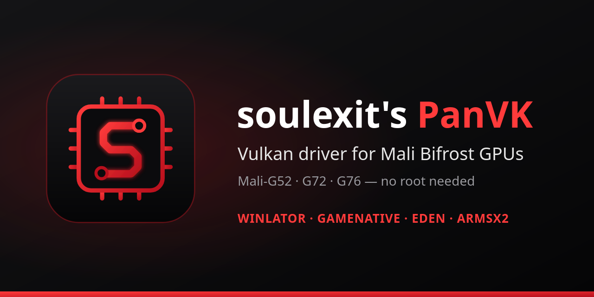

# soulexit's PanVK driver

A Vulkan driver for phones with **Mali Bifrost GPUs** (Mali-G52, G72, G76 and relatives).
Install it in **Winlator, GameNative, Eden, ARMSX2** or any app that can load custom drivers.
No root needed.

This page only has the releases, published when a version is stable enough for everyday use.
Source, test builds and development notes are in
[soulexit/panvk-kirin990](https://github.com/soulexit/panvk-kirin990).

> **Still experimental.** This driver needs more debugging and testing on different:
>
> - phone brands
> - Android ROMs and versions
> - apps (Winlator, GameNative, Eden, ARMSX2 and others)
> - DXVK, VKD3D-Proton and Vegas versions
>
> Test results, good or bad, help a lot: see [how to report](#something-not-working).

## Download

**[Latest release](https://github.com/soulexit/panvk-bifrost-soulexit/releases/latest)**: 1.0.003

| File | For |
|---|---|
| `soulexit-panvk-1.0.003.zip` | Winlator, GameNative, Eden and other apps |
| `soulexit-panvk-1.0.003-armsx2.zip` | ARMSX2 (same driver, named the way ARMSX2 needs) |
| `panvk-report.exe` | a tool that collects logs when something goes wrong ([below](#something-not-working)) |

Install the zip as it is (don't unzip it) from the app's driver manager, then pick it as the
graphics / Vulkan driver of your container or game.

**Versions:** Versioning has been changed for release drivers (1.0.000 = panvk-kirin990 1.3.0).

## Supported GPUs

Tested on these phones:

| GPU | Phone | Status |
|---|---|---|
| Mali-G76 MC16 | Huawei P40 (Kirin 990) | works: main test phone |
| Mali-G72 MP3 | Samsung Galaxy A51 (Exynos 9611) | works |
| Mali-G52 MC2 | Vivo V21s (Helio G80) | works, MediaTek note in [common problems](#common-problems) |

**May also work** (same GPU family, not tested yet): Mali-G71, G31, G51, G52 and G76 on other
chips, for example Helio G70/G80/G85/G88/G90/G95, Helio P60/P70, Kirin 970/980/810,
Exynos 9810/9820/9825/850 and Unisoc T610/T618. If you try one, please tell us how it went
in an [issue](https://github.com/soulexit/panvk-kirin990/issues/new/choose), working or not.

**Not for:** Mali-G57, G68, G77, G78, G310, G610, G710 and newer (Valhall and later), or older
Mali-T GPUs. See [other drivers](#other-panvk-drivers) for those.

## Common problems

| Problem | Try this |
|---|---|
| Not sure the game is using this driver | Run `panvk-report.exe` in the same container: its first line names the driver in use. GameNative's own driver screen always shows the phone's normal driver. |
| Black screen or freeze with Winlator's **Renderer Driver** set to this driver | Use 1.0.000 or newer, or set the Renderer Driver to **System**: games still use this driver. |
| 32-bit games crash at start on a **MediaTek** phone | Add `WRAPPER_RESOURCE_TYPE=opaque` to the container's environment variables. |
| Wrong or missing textures, slow loading | Set **BCn emulation** to **None**: the driver handles these textures itself. |
| Low FPS in older (DirectX 9) games | Use Box64's **Performance** preset. |
| Game closes in busy scenes, or other apps get closed | Create `panvk_env.txt` in the phone's **Download** folder with the line `heap_memory_percent=0.42`. |
| No OpenGL games in Winlator on Android 10 | Add the environment variable `BOX64_LIBGL` = `/data/data/com.winlator.cmod/files/contents/adrenotools/soulexit-panvk-1.0.003/libGL_memfd.so` (use the version you installed) |
| A game glitches with a newer DXVK | Try an older DXVK (1.10.3), or the other way around. |
| A DirectX 12 game asks for feature level 12_0 | Add `VKD3D_FEATURE_LEVEL=12_0` to the container's environment variables. |
| Black screen with sound on **Huawei** phones with HarmonyOS 4.2 or EMUI 12 (kernel 5.10); `panvk-report`'s GPU self-tests fail there | Update to 1.0.001 or newer. |
| ARMSX2 closes when the screen rotates (black screen, then it exits) | Update to 1.0.002 or newer. |
| ARMSX2 games are slow or stutter | Update to 1.0.003 or newer, and in ARMSX2's graphics settings set **Hardware Download Mode** to **Unsynchronized**. |
| ARMSX2 doesn't list the driver | Install the `-armsx2` zip. |

## Something not working?

`panvk-report.exe` collects the driver's error log, the app's logs and your container settings
into one zip:

1. Download `panvk-report.exe` from the release and put it in the phone's **Download** folder.
2. Play until the problem happens, then close the game.
3. Open the **same container** and run `panvk-report.exe` (in Winlator, drive `D:` is the
   Download folder; in GameNative, add it as a custom game with the same settings).
4. It saves `panvk-report-<date>.zip` in **Download**. Attach that zip to a
   [bug report](https://github.com/soulexit/panvk-kirin990/issues/new/choose) with the game's
   name and what you saw.

The zip contains no passwords or account data. Full guide:
[REPORTING.md](https://github.com/soulexit/panvk-kirin990/blob/main/docs/REPORTING.md).

## Other PanVK drivers

If this driver doesn't work on your phone, one of these might:

| Driver | GPUs |
|---|---|
| [zenithblue PanVK](https://github.com/zenithblue-oss/panvk-kbase-android) | most Mali GPUs, Bifrost to 5th Gen (G52, G72, G57, G710, G720 … G1-Ultra); this driver is built on its Bifrost work |
| [FristOneRR PanVK](https://github.com/FristOneRR/FristOneRR-Panvk-Driver) | Mali-G57 (Helio G99, Dimensity 6080/6100+ and others) |
| [faux123's PanVK builds](https://github.com/faux123?tab=repositories&q=panvk) | one build per device: Mali-G57, G77, G610, G710 |
| [PanVK-Droid](https://github.com/Koadzba/PanVK-Droid) | Mali Bifrost, older Mesa 24 |

## Source

Built from Mesa's PanVK with
[zenithblue's patches](https://github.com/zenithblue-oss/panvk-kbase-android) and our own fixes.
Source code, build steps, tests and the full change list:
[soulexit/panvk-kirin990](https://github.com/soulexit/panvk-kirin990).

## License

MIT, see [LICENSE](LICENSE). Mesa's code stays under Mesa's licenses.
